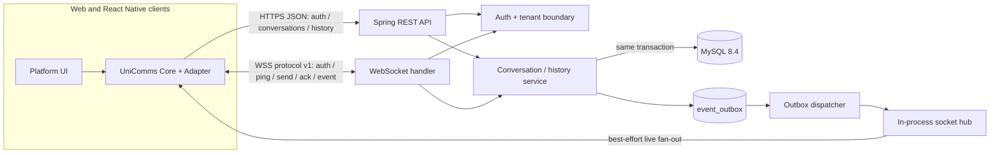
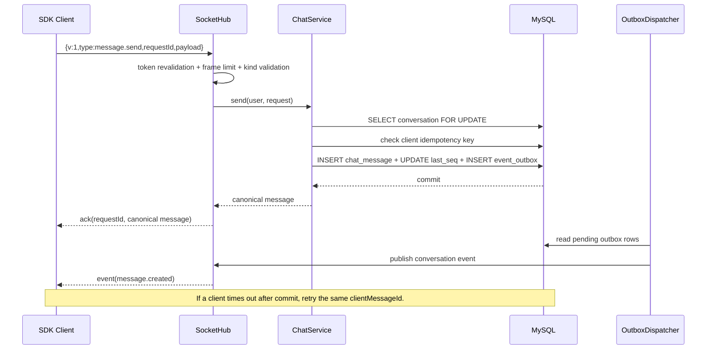

# comms-server

Java 21 / Spring Boot reference backend for UniComms-SDK. The service separates REST account/history APIs from a versioned WebSocket live-message protocol. MySQL is the primary database; Flyway owns schema evolution.

## Service architecture



## Send flow and transaction boundary



## Start locally

Recommended: Docker Engine with Compose. From this repository:

```sh
docker compose up --build -d
docker compose logs -f server
curl -fsS http://127.0.0.1:8080/actuator/health
```

This starts an isolated MySQL 8.4 container on `127.0.0.1:3307` and the API on `127.0.0.1:8080`. Compose enables registration for local demo only. The default application profile disables public registration. Override local values with environment variables; do not commit production secrets.

To run the API directly against the independent Compose database:

```sh
docker compose up -d mysql
source scripts/env.sh
mvn spring-boot:run
```

For a disposable H2 database without Docker, run `mvn spring-boot:run -Dspring-boot.run.profiles=local`. This is a development convenience, not a substitute for MySQL integration validation.

## REST API v1

All errors use `{ code, message, retryable, traceId }`. Authenticated routes require `Authorization: Bearer <token>`.

| Method | Path | Description |
|---|---|---|
| POST | `/api/v1/auth/register` | Local demo registration; disabled by default |
| POST | `/api/v1/auth/login` | Create a random bearer session |
| POST | `/api/v1/auth/logout` | Revoke current session |
| GET | `/api/v1/users` | List same-tenant users for demo conversation creation |
| GET/POST | `/api/v1/conversations` | List or create a conversation |
| GET | `/api/v1/conversations/{id}/messages?after={seq}&limit=100` | Exclusive forward history cursor |
| GET | `/api/v1/conversations/{id}/messages?before={seq}&limit=100` | Exclusive backward cursor |
| PUT | `/api/v1/conversations/{id}/read` | Advance read receipt monotonically |

`POST /api/v1/conversations/{id}/messages` is a REST fallback; live SDK sends use WebSocket.

Example registration:

```sh
curl -sS http://127.0.0.1:8080/api/v1/auth/register \
  -H 'Content-Type: application/json' \
  -d '{"tenant":"demo","username":"alice","password":"correct-horse-123","displayName":"Alice"}'
```

## WebSocket protocol v1

Endpoint: `ws://127.0.0.1:8080/ws` locally. Every client frame has `v`, `type`, `requestId`, and `payload`. The first frame must authenticate.

```json
{"v":1,"type":"auth","requestId":"req-1","payload":{"token":"<session-token>"}}
{"v":1,"type":"message.send","requestId":"req-2","payload":{"conversationId":"<uuid>","clientMessageId":"stable-client-id","kind":"text","payload":{"text":"Hello"}}}
```

Server replies include `traceId`. A committed message gets `ack` with the original `requestId`; recipient updates arrive as `event` with `eventType: message.created`. Supported initial message plugins are `text`, `image`, `audio`, and `location`. Binary media upload is deliberately outside this reference service; media payloads must use HTTPS URLs.

Operational limits in this starter: maximum 16 KiB WebSocket text frame, 40 frames/second per socket, 2,000 concurrent sockets per process, 5-second authentication deadline, and 45-second idle expiry. These are conservative defaults, not benchmark-certified capacity targets.

## Configuration

| Variable | Default | Purpose |
|---|---|---|
| `PORT` | `8080` | HTTP/WebSocket port |
| `BIND_ADDRESS` | `127.0.0.1` | Bind interface; Compose uses container interface |
| `DB_URL` | local MySQL on 3307 | JDBC URL |
| `DB_USER` / `DB_PASSWORD` | local demo credentials | Database credentials |
| `REGISTRATION_ENABLED` | `false` | Allow self-service registration |
| `ALLOWED_ORIGINS` | local Vite origins | Explicit browser CORS allowlist |
| `TOKEN_HOURS` | `24` | Session lifetime |

The project pins Spring Boot 3.5.16 and targets Java 21; Spring Boot 3.5.16 supports Java 17 through 25 and Maven 3.6.3 or later ([official system requirements](https://docs.spring.io/spring-boot/3.5/system-requirements.html)).

## Security and deployment boundary

- Passwords are BCrypt-hashed; bearer tokens are generated from secure random bytes and only their SHA-256 hashes are stored.
- Tenant identity is checked for users, conversations and memberships. Clients cannot select another tenant through message payloads.
- Registration is off in the default profile; Compose opts in only for local demo. Change credentials and origins before any shared deployment.
- This project is an executable reference implementation, not a hardened public SaaS service. Add account-level throttling, abuse detection, secrets management, TLS termination, media upload authorization, retention policy, and security review before production exposure.
- Socket sessions and outbox dispatch are process-local. Do not horizontally scale this implementation as-is. A production multi-node topology needs event broker fan-out and leased/claimed outbox delivery.

## Source map

- `auth/`: credential checks, token creation/revocation, tenant-scoped user listing.
- `chat/`: membership checks, idempotent durable send, history cursors, read receipt.
- `transport/`: WebSocket protocol handler and after-commit outbox fan-out.
- `src/main/resources/db/migration/`: versioned schema.
- `compose.yaml`, `Dockerfile`: isolated local MySQL + API startup.
